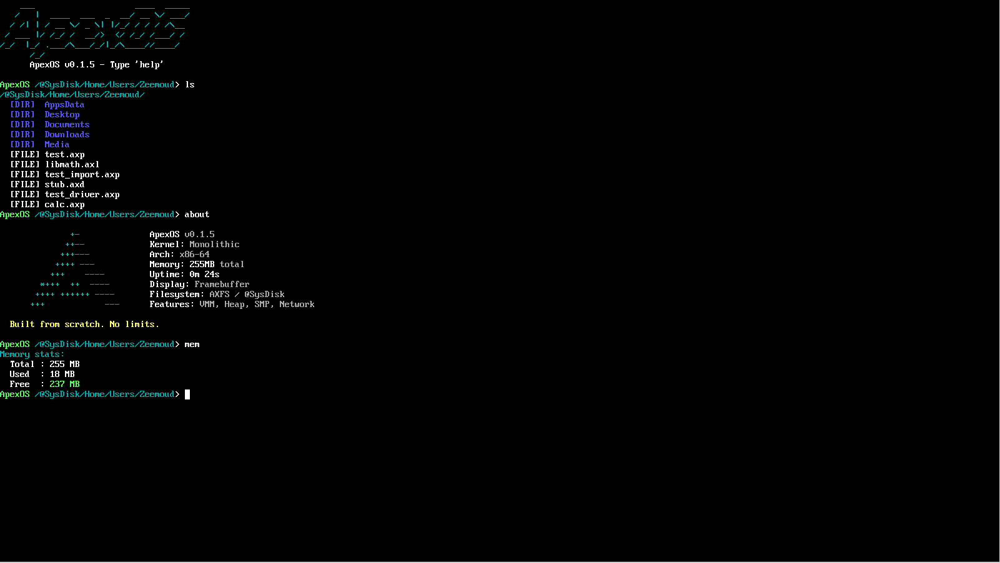
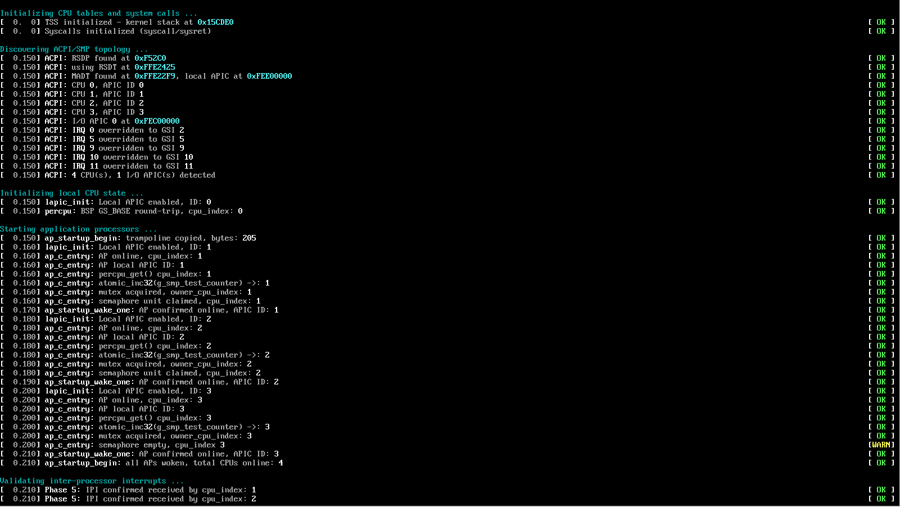
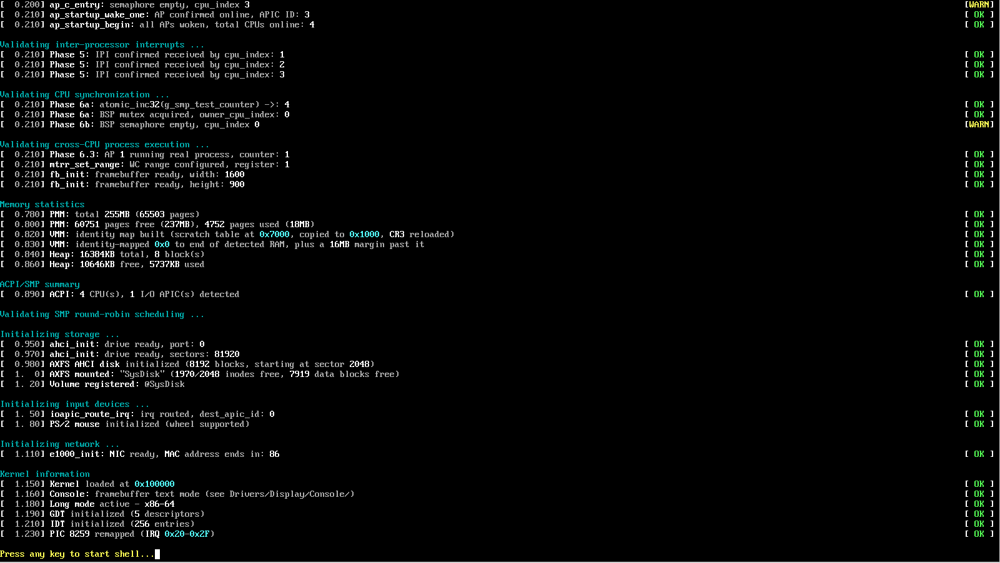
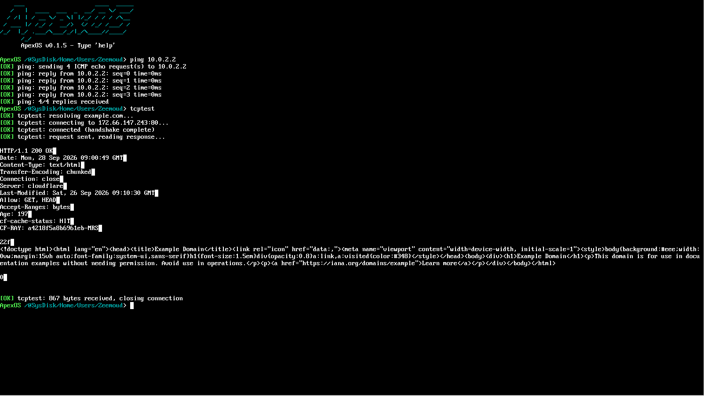
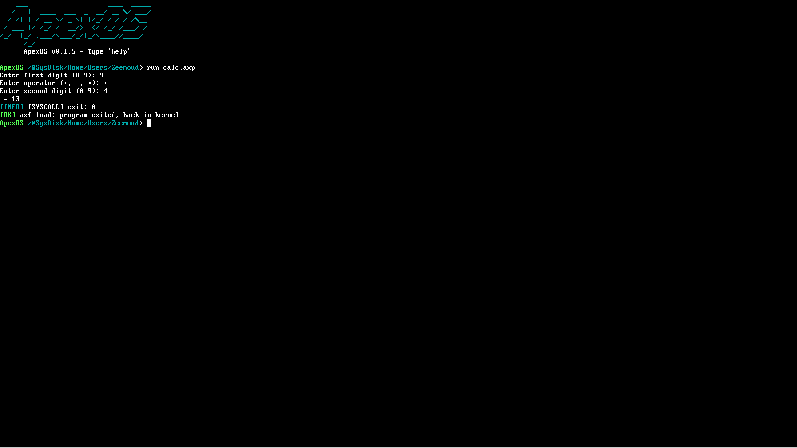
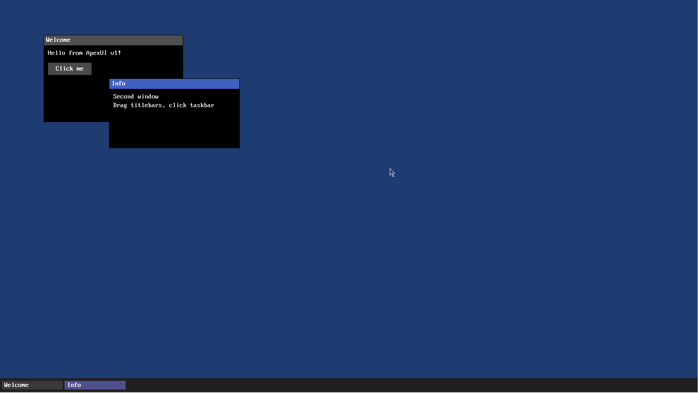

<h1 align="center">ApexOS</h1>

<p align="center">
  A 64-bit operating system written from scratch in C and NASM assembly.<br>
  Custom bootloaders, SMP kernel, native filesystem, executable format and network stack.
</p>

<p align="center">
  
  
  
  
  
  
</p>

<p align="center">
  
</p>

---

## Table of contents

1. [Overview](#overview)
2. [Screenshots](#screenshots)
3. [Project status](#project-status)
4. [Architecture](#architecture)
5. [Security hardening](#security-hardening)
6. [Building and running](#building-and-running)
7. [Debugging](#debugging)
8. [Testing](#testing)
9. [Repository layout](#repository-layout)
10. [Known limitations](#known-limitations)
11. [Roadmap](#roadmap)
12. [Contributing](#contributing)
13. [License](#license)

---

## Overview

ApexOS is an independent, monolithic-kernel operating system for x86-64. It does not use GRUB, Multiboot or any existing kernel: the bootloaders, the kernel, the filesystem, the executable format and the network stack are all implemented in this repository, with no libc and no third-party runtime.

Design goals:

- **Understandable.** Every subsystem is small, self-contained and commented with the reasoning behind non-obvious decisions.
- **Correct before fast.** Cross-CPU behaviour, memory permissions and untrusted input (userspace pointers, executable formats, on-disk structures) are treated as hostile by default.
- **Own formats.** ApexOS defines its own executable format (AXF) and filesystem (AXFS) rather than reimplementing existing ones.

The codebase is roughly 28,000 lines of C and assembly.

---

## Screenshots

All captures are taken from ApexOS running under QEMU (q35, 4 CPUs, 1600x900 framebuffer).

<details open>
<summary><b>SMP boot on 4 CPUs</b></summary>

ACPI/MADT discovery, then each application processor woken through the trampoline and reporting online, followed by IPI validation, memory statistics and storage, input and network initialisation.

<p align="center">
  
</p>
<p align="center">
  
</p>

The two `[WARN]` lines are expected: the boot semaphore test is initialised with two units and requested by four CPUs, so the last two find it empty.

</details>

<details open>
<summary><b>Network stack: ICMP, DNS and TCP</b></summary>

`ping` against the QEMU gateway, then `tcptest`: DNS resolution of `example.com`, TCP three-way handshake, an HTTP request and the `200 OK` response received through the hand-written stack (the body is shown as received, still chunk-encoded).

<p align="center">
  
</p>

</details>

<details open>
<summary><b>Userspace (Ring 3)</b></summary>

`run calc.axp` loads an AXF program from AXFS, executes it in Ring 3 using system calls for input and output, and returns to the kernel through `SYS_EXIT`.

<p align="center">
  
</p>

</details>

<details open>
<summary><b>ApexUI</b></summary>

Early graphical layer on the framebuffer: overlapping windows with title bars, a button widget, a taskbar with one entry per window, and a mouse cursor.

<p align="center">
  
</p>

</details>

---

## Project status

ApexOS is in early development (`v0.1.5`). It boots and runs on QEMU (BIOS and UEFI, 4 CPUs).

| Area                                 | State            | Notes                                                         |
| ------------------------------------ | ---------------- | ------------------------------------------------------------- |
| BIOS bootloader                      | Working          | Two-stage, real mode to long mode                             |
| UEFI bootloader                      | Working          | GOP framebuffer, GPT reader, memory map, `ExitBootServices`   |
| Memory management                    | Working          | Bitmap PMM, 4-level VMM, W^X, kernel heap                     |
| Interrupts and timer                 | Working          | GDT, IDT, TSS, PIC 8259, PIT at 100 Hz                        |
| Syscalls and Ring 3                  | Working          | `syscall`/`sysret`, validated user pointers                   |
| SMP                                  | Working, partial | 4 CPUs online, IPIs, TLB shootdown; round-robin test disabled |
| Scheduler                            | Working          | Preemptive; multi-CPU test pending (see limitations)          |
| Storage                              | Working          | AHCI (SATA) plus RAM backend                                  |
| Filesystem                           | Working          | AXFS with journal, VFS with `@Volume` prefixes                |
| Executable format                    | Working          | AXF: `.axp` programs, `.axl` libraries, `.axd` drivers        |
| Display                              | Working          | VGA text, VBE/GOP framebuffer console, MTRR write-combining   |
| Input                                | Working          | PS/2 keyboard and mouse (wheel)                               |
| Networking                           | Partial          | Intel e1000, Ethernet, ARP, IPv4, ICMP, UDP, TCP (client)     |
| ApexUI                               | Early            | Compositor, window manager, taskbar, widgets                  |
| Package manager, toolchain, userland | Planned          | Directories exist, still empty                                |

---

## Architecture

### Boot flow

```
                 BIOS                                   UEFI
                   |                                      |
     stage1 (MBR, 512 B) -> stage2               BOOTX64.EFI (GOP, GPT,
       real mode -> protected -> long              memory map, ExitBootServices)
                   \                                      /
                    \____________ kernel.bin _____________/
                                     |
                              kmain()  (0x100000)
     memory -> interrupts/timer -> ACPI/MADT -> LAPIC -> per-CPU -> APs
        -> IPI and sync validation -> framebuffer -> storage -> AXFS/VFS
        -> drivers (AXD) -> input -> network -> shell
```

Both boot paths load the same `kernel.bin` and pass information (memory map, framebuffer, ACPI RSDP, disk layout) through structures at fixed low-memory addresses that the bootloaders and the kernel agree on.

### Physical and virtual memory layout

| Region         | Address              | Purpose                            |
| -------------- | -------------------- | ---------------------------------- |
| Kernel PML4    | `0x1000`             | Shared by every CPU                |
| AP trampoline  | `0x8000`             | Copied by the BSP before each SIPI |
| Kernel image   | `0x100000`           | Loaded here, see `Linker.ld`       |
| User code      | `0x400000`           | AXP text                           |
| User libraries | `0x600000`           | AXL mappings                       |
| User stack     | `0x700000`           | 16 KiB                             |
| Kernel heap    | `0x4000000` (64 MiB) | 16 MiB, mapped non-executable      |
| I/O APIC       | `0xFEC00000`         | MMIO, uncached                     |
| Local APIC     | `0xFEE00000`         | MMIO, uncached                     |

Physical RAM is identity-mapped from `0x0` to the end of detected RAM plus a 16 MiB margin, so firmware tables placed just past RAM stay reachable.

### SMP bring-up

1. The BSP parses ACPI (RSDP, RSDT, MADT) to enumerate CPUs and I/O APICs.
2. Each AP is woken one at a time: the BSP copies the 16-bit trampoline to `0x8000`, fills a shared data block (stack top, C entry point, CPU index) and sends INIT then SIPI.
3. The trampoline switches real mode, protected mode, then long mode, reusing the BSP's already-built kernel page tables, and calls `ap_c_entry()`.
4. The AP loads the IDT, initialises its Local APIC and per-CPU slot (`GS_BASE`), and reports online.

Because the kernel heap and AP stacks are mapped with the NX bit, **the trampoline must enable `EFER.NXE` in addition to `EFER.LME`**: otherwise bit 63 is a reserved bit on the AP, and the first stack access raises a page fault that ends in a triple fault (no IDT is loaded yet at that point).

### System call ABI

Invoked with the `syscall` instruction; the result is returned in `rax`.

| Number | Name              | Description                                         |
| ------ | ----------------- | --------------------------------------------------- |
| 0      | `SYS_EXIT`        | Terminate the calling process                       |
| 1      | `SYS_WRITE`       | Write to the console                                |
| 2      | `SYS_READ`        | Read input                                          |
| 3      | `SYS_GETPID`      | Current process ID                                  |
| 4      | `SYS_SLEEP`       | Reserved; currently a stub that returns immediately |
| 5      | `SYS_DRIVER_CALL` | Call an exported function of a loaded `.axd` driver |

All user-supplied pointers are checked against an allowlist of user regions before the kernel dereferences them.

### AXF executable format

| Extension | Kind    | Runs in | Notes                                                 |
| --------- | ------- | ------- | ----------------------------------------------------- |
| `.axp`    | Program | Ring 3  | Standalone executable                                 |
| `.axl`    | Library | Ring 3  | Import/export tables, real cross-binary calls         |
| `.axd`    | Driver  | Ring 0  | Loaded by the kernel, reachable via `SYS_DRIVER_CALL` |

Every header field, offset, size and count is validated with overflow-safe range checks before use.

### AXFS and VFS

AXFS is a native filesystem with a superblock, bitmap allocation of inodes and data blocks, and a journal. It runs on a RAM backend or on a real disk through the AHCI driver. The VFS layer routes paths of the form `/@SysDisk/Home/...` to the right volume and is designed to accept further filesystem types.

### Networking

```
e1000 -> Ethernet -> ARP
                  -> IPv4 -> ICMP (ping)
                          -> UDP  (DNS client)
                          -> TCP  (client, one connection)
```

TCP implements the three-way handshake, data transfer and stop-and-wait retransmission. Addressing is static (QEMU user-mode defaults, `10.0.2.15`); there is no DHCP client.

---

## Security hardening

A manual static audit of the kernel produced 16 findings, all fixed. Highlights:

| Area        | Issue                                                                                   | Fix                                                                                          |
| ----------- | --------------------------------------------------------------------------------------- | -------------------------------------------------------------------------------------------- |
| Memory      | No W^X: heap and user stacks were executable                                            | `EFER.NXE` enabled; heap and user stacks mapped NX                                           |
| Syscalls    | Unvalidated user pointers in `sys_read`/`sys_write`                                     | Range validation against a user-region allowlist                                             |
| AXF loaders | Integer overflows in offset/size arithmetic (7 sites)                                   | `SafeRange` helpers (`axf_range_fits`, `axf_array_fits`)                                     |
| AXD drivers | Export offset never validated (Ring 0 code execution)                                   | Bound and per-entry checks                                                                   |
| Heap        | `kcalloc` overflow, `kfree` double free, no SMP lock                                    | Overflow guard, double-free detection, IRQ-safe spinlock                                     |
| AXFS        | Block leak on failed write, double free, silent path truncation, unvalidated superblock | Cleanup on every error path, bitmap checks, explicit truncation error, mount-time validation |
| VMM         | `pml4` / `active_pml4()` inconsistency in unmap paths                                   | Unified on the active PML4                                                                   |
| Boot        | Unchecked UEFI `AllocatePool`, GPT division by zero, MADT walk without bounds           | Status checks and bounds checks                                                              |

Details are in the commit history.

---

## Building and running

### Requirements

- `nasm`, `gcc`, `ld`, `objcopy`
- `qemu-system-x86_64` (KVM optional)

### Make targets

| Target               | Description                                                       |
| -------------------- | ----------------------------------------------------------------- |
| `make`               | Build `Build/apex.img`                                            |
| `make run`           | Build and boot in QEMU (q35, 4 CPUs, 256 MiB, e1000, SDL display) |
| `make debug`         | Boot paused, GDB server on port 1234                              |
| `make run-debug-int` | Boot with interrupt logging                                       |
| `make run-emergency` | Fallback boot configuration                                       |
| `make clean`         | Remove build output                                               |

After changing the Makefile or an assembly source, do a clean rebuild (`rm -rf Build && make`) so stale objects are not linked.

### UEFI

```bash
./Meta/Scripts/Bash/test-uefi.sh     # full rebuild: builds BOOTX64.EFI and a fresh test image
./Meta/Scripts/Bash/rerun-uefi.sh    # relaunch the last UEFI image without rebuilding
```

Both scripts use paths relative to the current directory, not to the script itself: run them from the project root, as shown above.

### Using the shell

Once booted, press any key to reach the shell. Available commands:

`help` `clear` `about` `mem` `uptime` `echo` `ls` `cd` `mkdir` `touch` `write` `cat` `rm` `run` `test` `ring3` `gfxtest` `apexui` `disktest` `arptest` `ping` `dnstest` `tcptest` `serialmirror` `reboot` `shutdown`

---

## Debugging

```bash
make debug                  # terminal 1: QEMU paused, GDB server on :1234
gdb Build/kernel.elf        # terminal 2
(gdb) target remote :1234
```

For triple faults, log the exception chain instead of inspecting registers after the reset (registers shown after a triple fault are the post-reset state and are misleading):

```bash
qemu-system-x86_64 ... -d int,cpu_reset -D qemu.log -no-reboot
grep -B2 -A25 "check_exception\|Triple fault" qemu.log
```

The log gives the exception vector, error code, `CR2` and `RIP` of the first fault.

Console output can be mirrored to COM1 (`serialmirror` in the shell, or `-serial stdio` under QEMU), which allows headless runs and scripted checks. Early boot lines are buffered until the framebuffer takes over, then imported into its scrollback.

---

## Testing

The kernel embeds a self-test suite, run with `test` from the shell. It covers GDT, IDT, PIT, PMM, VMM, heap, scheduler, AXFS and VFS (sources in [`Tests/`](Tests/)).

Boot itself acts as an integration test: it validates IPI delivery to every AP, atomics, mutex and semaphore behaviour across CPUs, and the execution of a real process on a secondary CPU, and reports each step in the boot log.

---

## Repository layout

```
ApexKernel/
  Arch/x86_64/        GDT, syscall entry, context switch, AP trampoline, MTRR
  Boot/               BIOS (stage1/stage2) and UEFI bootloaders
  Bus/                PCI, serial
  Core/               Init, ACPI, interrupts, memory, SMP, synchronisation,
                      scheduler, syscalls, shell, boot log
  Devices/            Low-level device helpers
  Drivers/            Display, input, AHCI, e1000
  Filesystem/         AXFS and VFS (FAT32 planned)
  Formats/AXF/        AXP, AXL, AXD loaders
  Network/Protocols/  ARP, Ethernet, IPv4, ICMP, UDP, TCP
  Includes/           Headers, mirroring the source tree layout
ApexLib/               Freestanding base library (types, logging)
ApexUI/                Compositor, window manager, taskbar, widgets
Tests/                 In-kernel test suites
Meta/
  Screenshots/          Images used by this README
  Scripts/Bash/         Shell helper scripts (mirror_includes*.sh, test-uefi.sh, rerun-uefi.sh)
  Scripts/Python/       Python helper scripts (make_calc_axp.py)
ApexPKG/  ApexToolchain/  Userland/  Documentation/    Planned, currently empty
Linker.ld  Makefile
```

Build conventions: C11, freestanding, no libc, no stack protector, no red zone, and no SSE/MMX code generation (the kernel does not save that state on interrupts or context switches). `-Wall -Wextra` are enabled. Builds currently use `-O0 -g`.

---

## Known limitations

- **SMP scheduling.** The multi-CPU round-robin scheduling test is disabled because of a known race; scheduling across secondary CPUs is not enabled by default.
- **`SYS_SLEEP`.** Defined in the ABI but not implemented yet.
- **TCP.** Client-only, one connection, stop-and-wait; no congestion control, window scaling or selective ACK.
- **Networking.** Static addressing (no DHCP client); no IPv6.
- **Filesystem.** AXFS only; no FAT32, ext4 or NTFS yet.
- **Hardware.** Developed and tested on QEMU; behaviour on physical machines is untested.

---

## Roadmap

- Fix the SMP scheduler race and re-enable multi-CPU scheduling
- Implement `SYS_SLEEP`
- Extend ApexUI (applications, theming)
- Event-driven scheduler
- Package format and manager (`.axpkg`, `ApexPKG/`)
- FAT32, ext4 and NTFS support, IPv6, DHCP, audio
- Userland and an AXF toolchain (`ApexToolchain/`), documentation (`Documentation/`)

---

## Contributing

The project is currently developed by a single author. Issues and discussions are welcome.

See [`CONTRIBUTING.md`](CONTRIBUTING.md) for setup instructions, design conventions and what to check before opening a pull request. For anything with a security implication, see [`SECURITY.md`](SECURITY.md) instead of opening a public issue.

---

## License

Released under the GNU General Public License v3.0. See [`LICENSE`](LICENSE).
